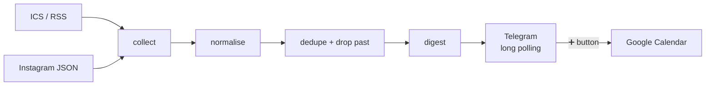

# Eventure

Watches the sources you already check by hand, keeps only the events that really
are upcoming, sends you **one Telegram digest**, and lets you add any of them to
your calendar with one button.

Location, language and timezone are **runtime configuration** (`config.toml`),
never values baked into the code.

Current state: works end to end with one ICS source + Instagram (optional) +
Google Calendar, running in Docker or without it.

## How it works



One message **per source family**: web feeds (`ics`, `rss`) and Instagram arrive as
separate messages, so a caption guess never sits in the same list as a structured
feed. Each message carries its own buttons and names only the sources it covers. A
family with nothing new and no failing source is skipped rather than sent empty.
Events that carry an image arrive first as **photo cards** (image + its own button);
the rest stay in the list. If the source has no image, no logo is substituted —
nothing is invented to fill the space.

Three guarantees that are implemented, not just promised:

- **"No events" is never confused with "collection broke".** If every source
  fails, an error notice is sent; if one fails, the digest footer names it.
- **The calendar can fail without taking the bot down.** With no token, or a
  revoked one, the digest still arrives and the button replies with the reason.
- **Instagram is isolated.** If Meta breaks the session, only that source is lost
  and the rest of the digest still goes out.

## Requirements

| Needed | For |
|---|---|
| Docker + Docker Compose | The recommended way |
| Telegram bot (token from @BotFather) | Receiving the digest and pressing buttons |
| Google account with Calendar | Writing events (optional) |
| Python 3.11+ | Only if you run without Docker, or to generate the Google token |
| Instagram account | Optional, only for Phase 3 |

---

## Getting started

### 1. Base files

```sh
mkdir -p data secrets
cp config.example.toml config.toml     # your settings; git-ignored
cp sources.example.txt sources.txt     # your watch list; git-ignored
```

Neither `config.toml` nor `sources.txt` is committed: they hold your chat id, your
sources and your accounts. The repository ships the two `.example` templates only.

There are two lists, on purpose:

- **`sources.txt`** is yours. One URL per line, nothing to learn, used by the Phase 0
audit to find out what a site actually publishes.
- **`config.toml`** is what the worker polls, with an explicit `type` per source.

You should not have to keep them in sync by hand:

```sh
python3 -m eventure sources import --dry-run   # what would be added
python3 -m eventure sources import             # write the missing [[source]] blocks
```

It only writes a source it can actually read: a URL becomes `ics`/`rss` when a feed
answers, an Instagram profile becomes `instagram_profile`, and anything unreadable
(including Facebook, which has no feed for third-party accounts) is reported instead
of silently dropped. A page already watched under another rendition — `/eventos/`
when you already poll `/eventos/?ical=1` — is recognised and skipped, so it never
adds the site-wide blog feed next to a proper events calendar. Config text is
re-parsed before writing, so a bad name can never leave `config.toml` unreadable.

### 2. Bot token

1. Open [@BotFather](https://t.me/BotFather) → `/newbot` → copy the token.
2. Write it yourself into `.env` (do not paste it into chats, issues or screenshots):

```dotenv
TELEGRAM_BOT_TOKEN=123456:ABC...
```

```sh
chmod 600 .env
```

> If the token leaks: `/revoke` in BotFather, paste the new one in `.env` and
> restart the container. Nothing else changes.

### 3. Your `chat_id`

1. Open your bot in Telegram and send it `/start`.
2. Get the id **without printing the token**:

```sh
set -a; . ./.env; set +a
curl -s "https://api.telegram.org/bot$TELEGRAM_BOT_TOKEN/getUpdates" \
  | grep -o '"chat":{"id":[-0-9]*' | head -1
```

3. Put that number in `config.toml`:

```toml
[telegram]
chat_id = 123456789
```

The bot replies **only** in that chat. If you add it to a group, the group's
messages are ignored on purpose.

### 4. Google Calendar

Guide with the exact clicks and an error table:
[`docs/google-calendar-setup.md`](docs/google-calendar-setup.md).

Short version:

1. OAuth client in **Personal mode**, type **Desktop app** → `client_secret.json`.
2. On your laptop (not the Pi): `python3 google_auth.py` → opens the browser, you
   approve "create or modify events", it writes `token.json`.
3. `mkdir -p secrets && mv token.json secrets/`.
4. Enable the API if it is not yet:
   <https://console.cloud.google.com/apis/library/calendar-json.googleapis.com>
   (the `403 ... has not been used in project` error gives you the exact link).

### 5. Start it

```sh
docker compose up -d --build
docker compose logs -f eventure
```

You should see two lines:

```
next digest in 25314s
polling for button presses (Ctrl-C to stop)
```

The first is the digest scheduled by `[schedule].times`; the second is the button
handler. It is **one process** (`eventure serve`) with two threads.

### 6. Verify before waiting for the schedule

```sh
# health of each source
docker compose exec -T eventure python -m eventure status

# builds the digest and prints it; sends nothing
docker compose exec -T eventure python -m eventure run --dry-run

# actually sends it
docker compose exec -T eventure python -m eventure run
```

If the digest arrives and the footer says `Fuentes: 1/2 OK`, it is working; the
rest is noise until you connect more sources.

---

## Configuration (`config.toml`)

| Section | Key | What it does |
|---|---|---|
| `[general]` | `language` | Digest labels and the first language tried for dates |
| | `timezone` | IANA zone; interprets times and schedules the digest |
| | `date_order` | `DMY` or `MDY` for ambiguous dates like `03/04` |
| | `horizon_days` | How far ahead to look |
| | `state_path` | Persistent state (`data/state.json` in Docker) |
| `[schedule]` | `times` | Local digest times, e.g. `["08:00","19:00"]` |
| | `run_on_start` | Send a digest when the container starts |
| `[location]` | `lat`/`lon`/`radius_km` | Optional; without them nothing is distance-filtered |
| `[telegram]` | `token_env`, `chat_id` | Name of the token variable, and the chat |
| `[google]` | `token_path`, `calendar_id` | Where the token lives and which calendar to use |
| `[[source]]` | `type` | `ics`, `rss`, `instagram_profile`, `instagram_json` |

`instagram_profile` sources are not read by the worker: they describe what
`ig_collect.py` should fetch. The worker consumes `instagram_json` and never talks
to Meta.

## Commands

| Command | Use |
|---|---|
| `eventure serve` | **What the container runs**: scheduled digest + buttons |
| `eventure run` | One digest now (`--dry-run` to only print it) |
| `eventure run --resend` | Re-send events already notified, for testing a fix (`--dry-run --resend` to preview); events already added or skipped stay quiet |
| `eventure run --resend --include-added` | Also replay events already in the calendar — for visual validation; their ➕ then replies "already added" instead of duplicating |
| `eventure poll` | Only the button handler |
| `eventure ics out.ics` | Full calendar, no credentials |
| `eventure status` | Per-source health, from stored state |
| `eventure sources import` | Add every readable source from `sources.txt` to `config.toml` (`--dry-run` to preview, `--probe` to try common feed paths) |
| `audit.py sources.txt` | Phase 0: which sources publish a feed? |

Without Docker, use `python3 -m eventure <command>`.

## How to know it works

- [ ] The digest arrives in the private chat, not the group.
- [ ] The footer says `Fuentes: N/M OK` (and names the ones that fail).
- [ ] Pressing ➕ replies "added to your calendar ✓" (translated to
      `[general].language`) and the event shows up in Google.
- [ ] Pressing the same ➕ again replies "it was already in your calendar".
- [ ] `docker compose restart eventure` does not resend already-notified events.

## Troubleshooting

| Symptom | Cause | Fix |
|---|---|---|
| `409 Conflict` in the logs | Two processes calling `getUpdates` (e.g. the local poller and the container) | Keep only one |
| `/start` gets no reply | Nothing was listening, or `chat_id` does not match | Check `chat_id` and `logs -f` |
| `403 ... has not been used in project` | Calendar API disabled | Use the link in the error → Enable |
| `invalid_grant` when pressing ➕ | Token revoked or expired | Repeat step 4 |
| `token.json is a directory` | Docker created a folder because the file was missing | Delete it and put the file back |
| `Instagram feed: missing` | `ig_collect.py` never ran | Instagram step, or remove that source |
| `feedback_required` from Instagram | Anti-abuse block on the web GraphQL endpoint | Use the default `instagrapi` engine, not `instaloader` (see below) |
| Digest always empty | Everything already notified, or every source is down | `status` and `run --dry-run` |
| Times shifted | Wrong `timezone` | Fix `[general].timezone` |

## Instagram (optional, isolated)

The login is yours to perform; the worker never talks to Meta. The collector uses
`instagrapi` (free, MIT), which goes through the private mobile API.

The public web GraphQL route (`instaloader`) is still in the code as `--engine
instaloader`, but it does not work: every `graphql/query` is answered with
`400 feedback_required` from this account and IP, with a fresh session, a browser
user-agent, and even with Chrome TLS impersonation via `curl_cffi`. The mobile API
is a different endpoint family, which is why it is the default.

**One-time login** (writes `data/ig_session.json`, prompts for the password — it is
never stored in config or env):

```sh
docker compose --profile instagram run --rm -it instagram \
  python ig_collect.py --engine instagrapi --login
```

Without Docker: `pip install instagrapi && python3 ig_collect.py --engine instagrapi --login`.
`$INSTAGRAM_USER` is used as the username if set, so only the password is asked.
Then collect on demand:

```sh
python3 ig_collect.py --engine instagrapi --days 14 --limit 12
docker compose --profile instagram up -d     # or let the loop do it every 6 h
```

It writes `data/instagram.json`. The worker only reads that file, so a broken
session degrades to one red source in the footer. A stale session is detected and
the collector says so instead of writing empty data silently.

What to expect: the caption is parsed for a date; the post's image becomes a
**photo card** with the event caption and its own ➕ button. Every Instagram event
and signal also names the **account it came from** (`sáb 28 nov · 21:00 ·
@modelobar_rockhouse`), because "Instagram feed" says nothing about where to go.
A carousel sends its first image, one card per event. Instagram's CDN links are
signed and expire after a few days, so if Telegram cannot fetch one the event still
arrives as text — the image is never allowed to cost you an event. A post announcing
**several nights** ("viernes 27 y sábado 28") becomes **one event per night**, each
with its own button, so ➕ adds the night you actually picked. A post whose details
live only in the flyer stays a **Signal** (a link you tap through); a caption with a
detectable date becomes an event marked ⚠ with no invented time.

Risk: this is an unofficial client on an account you care about. It can trigger a
checkpoint or a temporary action block. If that happens, log in at instagram.com,
clear the prompt, delete `data/ig_session.json` and log in again.

## Deploying to the Orange Pi

- **ARM64**: `docker compose build` compiles natively on the Pi. The base image is
  `python:3.12-slim` (multi-arch) and there are no compiled dependencies.
- **Permissions**: the image runs as UID 1000, the same as the default user on
  Raspberry Pi OS. If your user has a different UID:
  `sudo chown -R 1000:1000 data secrets`.
- **SD card**: state is a small JSON rewritten once per digest; logs are capped at
  10 MB × 3 per container.
- **No Chrome, no database, no local LLM.** All the work is HTTP and JSON.
- Copy `config.toml`, `.env`, `secrets/` and `data/`, then
  `docker compose up -d --build`.

## Without Docker (systemd)

```sh
sudo cp -r . /opt/eventure
sudo cp deploy/*.service deploy/*.timer /etc/systemd/system/
sudo systemctl enable --now eventure-poll.service eventure-run.timer
```

`deploy/` includes `eventure-poll.service` (always on), `eventure-run.timer`
(twice a day) and `eventure-ig.timer` (optional).

## Phase 0: feed audit

Before adding a source, check whether it publishes anything readable. The audit
reads `sources.txt` (copy it from the template if you have not yet):

```sh
cp sources.example.txt sources.txt   # one source per line
python3 audit.py --selftest
python3 audit.py sources.txt --probe
```

It classifies each source as `WORKS`, `EMPTY`, `NONE`, `ERROR` or `SOCIAL`, and
ends with a verdict on whether the feed approach is enough. Once the ones that work
are known, hand them to the worker:

```sh
python3 -m eventure sources import --dry-run
python3 -m eventure sources import
``` Details in
[`docs/design.md`](docs/design.md).

## Security posture

`SECURITY.md` explains how to report a vulnerability privately. The repository is
set up to score well on [OpenSSF Scorecard](https://github.com/ossf/scorecard):

| Control | How |
|---|---|
| SAST | CodeQL on push, pull request and weekly (`.github/workflows/codeql.yml`) |
| Fuzzing | Atheris harness for the caption date parser (`fuzz/fuzz_dates.py`) |
| Pinned deps | `requirements-ig.txt` and `fuzz/requirements.txt` carry sha256 hashes; base image pinned by digest |
| Updates | Dependabot covers pip, fuzz pip, GitHub Actions and Docker |
| CI tokens | `permissions: read-all` at workflow level; writes only in the one job that needs them |
| Release | A tag push publishes the image to GHCR with provenance and an SBOM |

```sh
make score     # OpenSSF Scorecard, from a clean tree
```

Two honest notes. Scorecard grades the **working tree**, and a stray `__pycache__`
drops Binary-Artifacts to 0 even though it is git-ignored — hence `make score`
cleaning first. And its local License detector reports 9/10 for Apache-2.0 even
when the file is byte-identical to apache.org's copy; upstream (GitHub) mode scores
it 10.

## Tests and layout

```sh
make test     # or: python3 -m unittest discover -s tests -t .
```

```
eventure/          collect, digest, store, telegram, gcal, ics, dates, http
audit.py           Phase 0: feed audit
sources.example.txt  template for your watch list (your sources.txt is private)
ig_collect.py      Instagram collector (instagrapi → JSON)
google_auth.py     OAuth consent, run on your laptop
deploy/            systemd units
fuzz/              Atheris harness for the date parser + hashed deps
.github/           CodeQL, fuzzing, release, Dependabot
SECURITY.md        how to report a vulnerability
Makefile           test, fuzz, clean, score, docker builds
requirements-ig.txt  hashed lockfile for the collector image
docs/              design and Google Calendar guide
```

## Non-goals

No city-specific services baked in, no local LLM inference, no vector database, no
message queue, no Kubernetes, no headless Chrome on the Pi.
